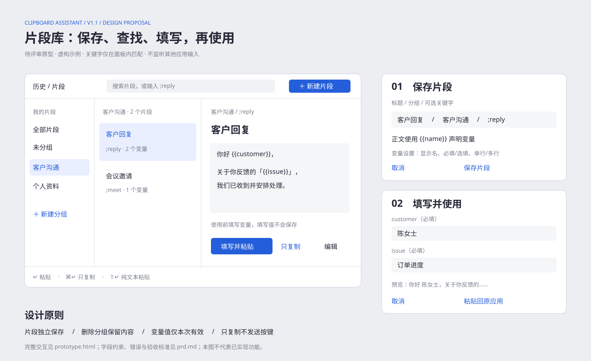

# v1.1 片段库 PRD

日期：2026-11-10。状态：已进入实现，macOS 验收待完成。本目录只设计片段库，不代表整个 v1.1 完成。

入口：[交互原型](prototype.html) · [技术方案](technical-design.md)。原型使用虚构数据，仅演示关键流程，不连接系统剪切板。

## 1. 目标与范围

把重复使用的文本保存为片段，按分组管理，通过搜索或关键字找到，在填完变量后复制或粘贴回呼出面板前的应用。

本次包含：纯文本片段、单层分组、面板内关键字精确匹配、文本变量及填写表单。不包含图片和富文本片段、系统全局打字替换、嵌套分组、脚本执行、系统环境变量、在线同步、片段导入导出。历史导入导出属于独立需求。

原有 AGENTS.md 的 v1 约束禁止加入片段库；设计阶段仅交付文档与原型；用户随后明确授权开始落地开发、TDD、修复中高风险并提交推送。本分支据此新增片段能力及附加表，既有历史表结构与主键不变。旧 technical-design.md 中删除顺序及 Sparkle 的描述与仓库约束冲突，本方案遵循仓库约束：先成功删除数据库行，不引入 Sparkle。

## 2. 本次实现采用的决策

1. 关键字只在片段页搜索框生效，例如 `;reply`；不会监控或替换其他应用正在输入的文字。
2. 首版只存纯文本。历史文本可主动保存，图片、文件和仅保存预览的超限条目不提供保存入口，避免把摘要当完整内容。
3. 分组单层，固定“全部片段”“未分组”，自建组按创建顺序排列。删除分组将片段移到未分组，不连带删除内容。
4. 变量仅文本、无默认值，支持必填和选填；重复变量只填一次。变量值只在本次表单会话保留。
5. 片段不受历史保留策略影响，清空历史不删除片段；删除片段单独确认。

## 3. 用户流程与界面

### 手动保存

主面板增加“历史 / 片段”切换，默认打开历史；片段页提供“新建片段”。历史文本右键“保存为片段”带入完整正文，保存后历史不变。编辑器包含标题、分组、可选关键字、正文和变量设置。

保存前校验：标题去首尾空白后 1–80 个字符；正文 1–100,000 个 UTF-8 字节，纯空白不允许；分组名 1–30 个字符；关键字为空或匹配 `;[A-Za-z][A-Za-z0-9_-]{0,31}`，忽略英文大小写全库唯一。标题可重复，片段不按正文去重。以上限额是本次建议值，不是现有实现。

保存成功关闭编辑器、选中新片段并刷新列表。失败保留全部输入并显示可重试错误；取消有改动时提示放弃或继续编辑。

### 分组与查找

左侧分组，中央列表，右侧正文预览。固定项不允许重命名或删除。自建组重名按去空白及英文大小写折叠判断；创建和重命名失败保留输入。片段通过编辑器更换分组。

查询在当前分组内对标题、正文、关键字进行不区分英文大小写的包含匹配。以分号开头进入关键字模式，按全库精确匹配并明确提示“跨分组匹配”；不完整关键字不执行，找不到时显示“没有匹配的关键字”。精确命中只选中，不自动粘贴。普通结果按更新时间倒序、ID 作为稳定次序。

空库显示新建引导；空分组显示“该分组暂无片段”；无搜索结果显示“未找到片段”，保留搜索条件。

### 变量与表单

正文用 `{{customer}}` 引用变量；变量名匹配 `[A-Za-z][A-Za-z0-9_]{0,31}`，区分大小写，最多 20 个唯一变量。编辑器按首次出现顺序生成变量设置，可设置中文显示名、必填/选填、多行/单行。新变量默认必填、单行。变量名重命名不自动改正文；移除后再次出现按新变量处理。

非法、嵌套或未闭合占位符阻止保存，并提示错误；需要原样输出的 `{{` 用 `\{{` 转义，`\\` 输出一个反斜杠。替换后的值不再被解析，例如用户输入 `{{x}}` 会作为字面文本输出。

选择有变量片段后按回车，打开填写表单；必填值去空白为空时不能执行，选填空值替换为空字符串。每个值最多 10,000 UTF-8 字节，最终展开结果最多 100,000 字节；超限保留表单且不写剪切板。实时预览最终文本，取消不写剪切板。无变量直接进入复制/粘贴流程。

表单只在视图内存中保留输入。取消、成功执行、关闭面板、切换片段时清除；粘贴失败保留当前表单用于重试。窗口退出到后台或退出应用不恢复变量值。

### 使用、键盘与失败

回车完整粘贴，⌘回车只复制，⇧回车纯文本粘贴。片段本身为纯文本，但三种意图仍沿用历史的模式语义和全局粘贴设置。表单的执行按钮注明当前动作；多行变量内回车换行，⌘回车提交当前动作，Tab 移动焦点，Escape 取消。

打开主面板时捕获目标应用，打开编辑器或变量表单不覆盖目标。发送 ⌘V 前关闭面板；未授权或目标失效时，沿用“未能自动粘贴，已复制，请手动粘贴”。只复制不发送按键。

编辑输入框保留系统 Delete、左右键、⌘Z；编辑器/表单内快捷键优先交给当前控件，禁止触发历史清空。片段浏览页 ⌘⌫ 不删除历史。删除通过明确菜单或按钮并二次确认，失败不得从列表消失。

## 4. 隐私与数据边界

不申请输入监控、屏幕录制，不记录后台打字。保存片段是用户显式输入操作，不从被隐私过滤的内容中恢复数据。模板和变量不进入日志、诊断 JSON、UserDefaults。复用自身写入抑制，展开后的内容不得因本应用写剪切板而再次采集为历史。

本地数据库不作加密承诺；片段不是密码保险箱。原型数据与用户数据完全无关。

## 5. 验收场景

- P01 新建无变量片段，重启后标题、正文、分组、关键字保持一致。
- P02 从完整文本历史保存，再删除原历史，片段仍可使用；超限预览条目不可保存。
- P03 创建、重命名、删除分组；删除组后片段进入未分组；数据库失败时界面不假成功。
- P04 `;reply` 跨分组精确命中，`;REPLY` 同样命中；普通查询受当前分组限制。
- P05 保存重复关键字被拒绝；两个同时提交的写入由唯一约束兜底。
- P06 重复变量只显示一个输入框，中文、换行、转义和选填空值得到准确输出。
- P07 缺少必填、非法模板、字段或展开结果超限时不写剪切板；输入保留。
- P08 取消填写不写剪切板，再次打开为空；变量值不落库、不进日志与诊断。
- P09 只复制不发送按键；表单出现后仍粘贴回最初目标；未授权显示手动粘贴提示。
- P10 清空历史、历史淘汰均不影响片段；新建片段不增加历史条数。
- P11 历史搜索、输入框编辑、清空确认及隐私过滤回归通过。
- P12 420px 窄窗仍能完成全部操作；VoiceOver 有控件名称；产品文案全部通过 L10n.text 提供中英文。

## 6. 交付顺序

先评审关键字触发范围、纯文本边界、变量语法与限额；再实现模型/解析器和测试；完成事务迁移与存储后接入编辑器和分组；最后接入变量表单、粘贴与回归验收。各阶段以测试与上述用例通过为完成标准，不预设发布日期。

## 7. 静态原型图

